<p align="center">
  
</p>

<p align="center">
  
  
  
  
  
</p>

<h1 align="center">Inkcadence</h1>

<p align="center">
  <a href="https://mafzalkalwardev.github.io/inkcadence/"><b>▶ Live site</b></a>
  &nbsp;·&nbsp;
  <a href="https://mafzalkalwardev.github.io/inkcadence/classic/"><b>Classic writer</b></a>
  &nbsp;·&nbsp;
  <a href="https://mafzalkalwardev.github.io/inkcadence/app/#/"><b>Vite app</b></a>
  &nbsp;·&nbsp;
  <a href="SELFHOST.md">Self-host</a>
  &nbsp;·&nbsp;
  <a href="SAAS.md">SaaS</a>
  &nbsp;·&nbsp;
  <a href="ML.md">ML</a>
</p>

> **Inkcadence learns your handwriting from your own pages and writes new ones in it** — classical glyph synthesis by default, optional neural personalization when the ML service is available. One repo, two deploy modes (`selfhost` | `saas`). Light and dark themes.

## See it work

The frames below are the Vite app, trained on this repo’s sample fixtures: 3 pages, a filled glyph sheet, quality **89/100**, **80/80** letterforms, then a rendered page. The paper stays paper-coloured in both themes.

<p align="center">
  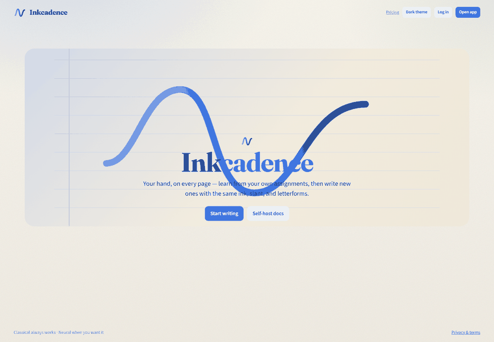
</p>

### Light and dark

| Light | Dark |
| --- | --- |
| 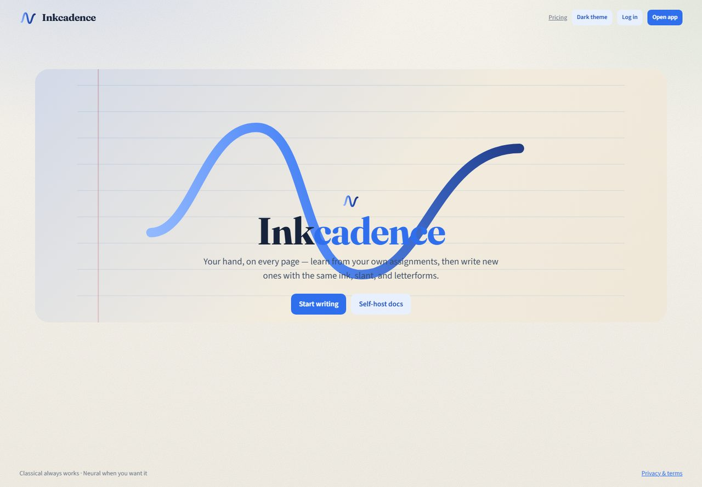 | 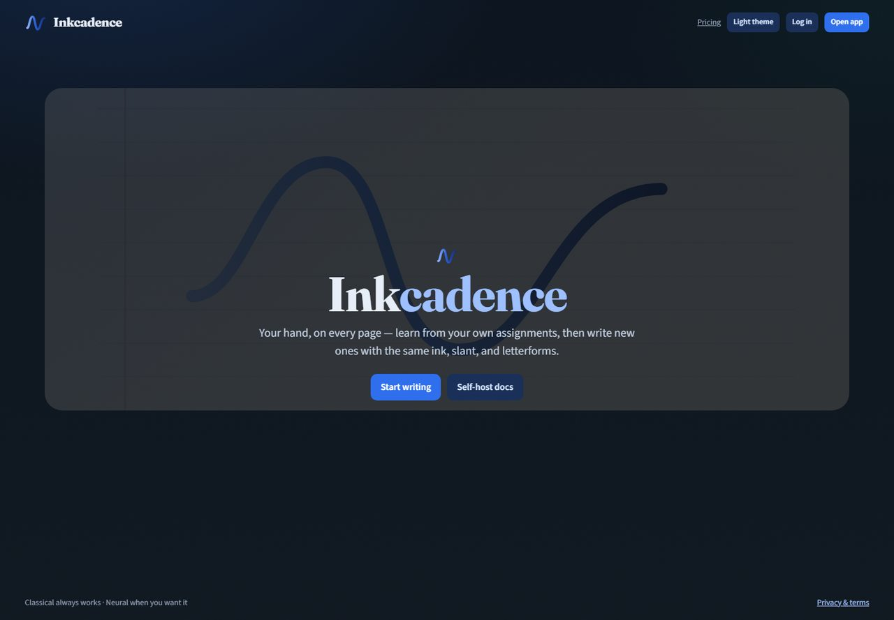 |
| 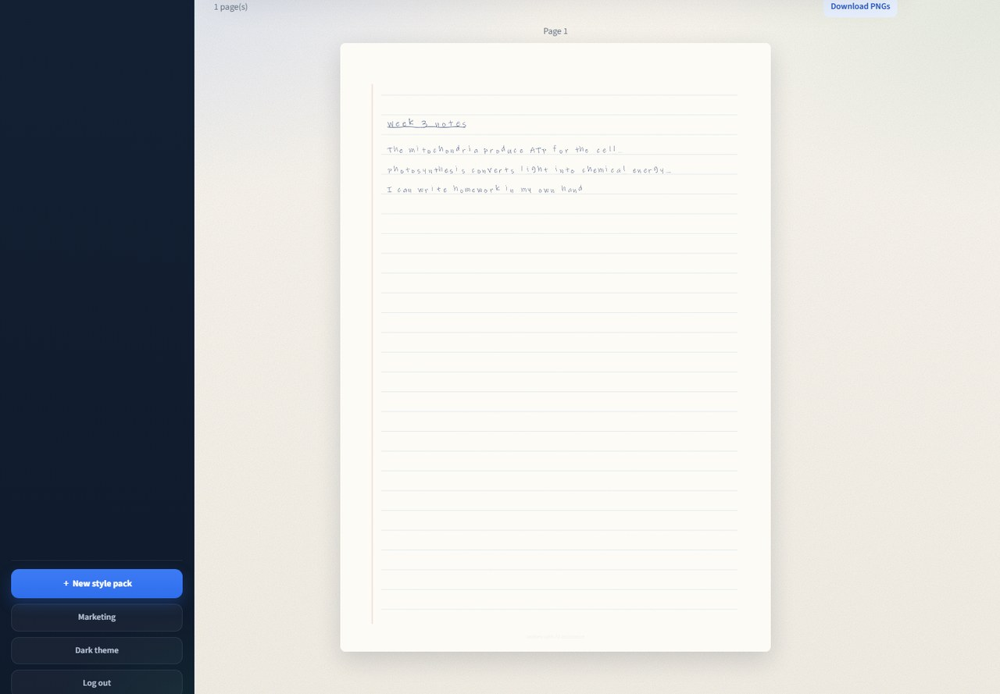 | 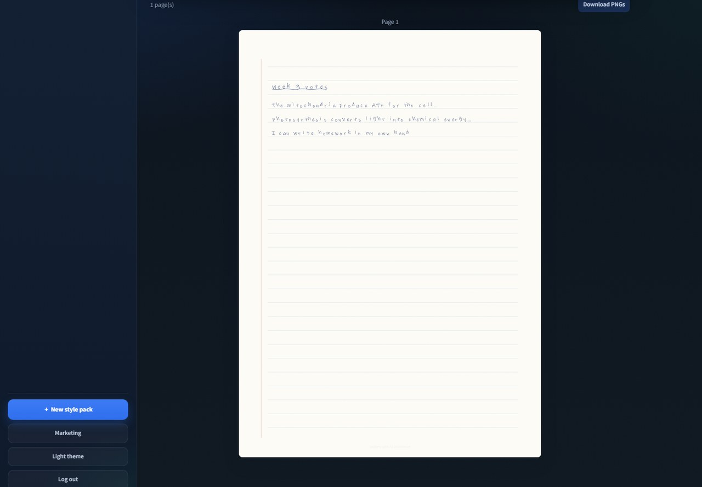 |

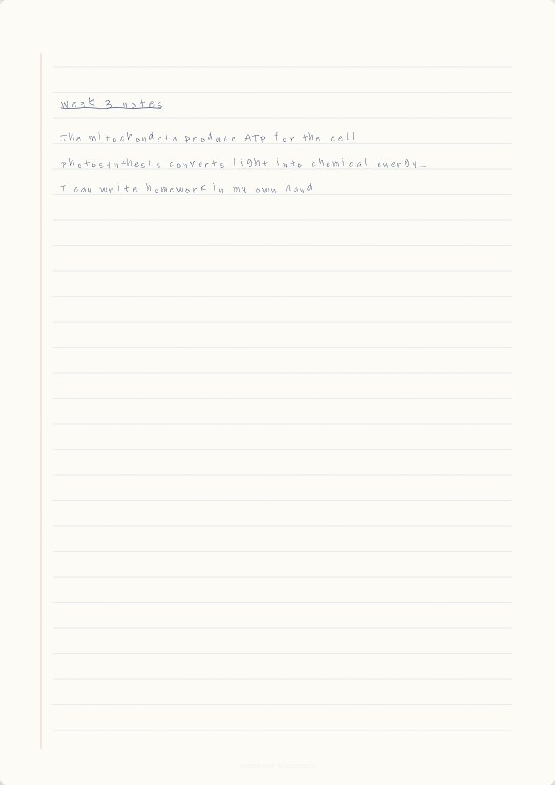

### Product workflow

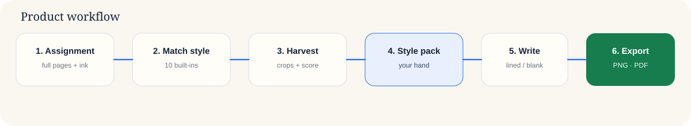

| Samples | Glyph sheet |
| --- | --- |
| 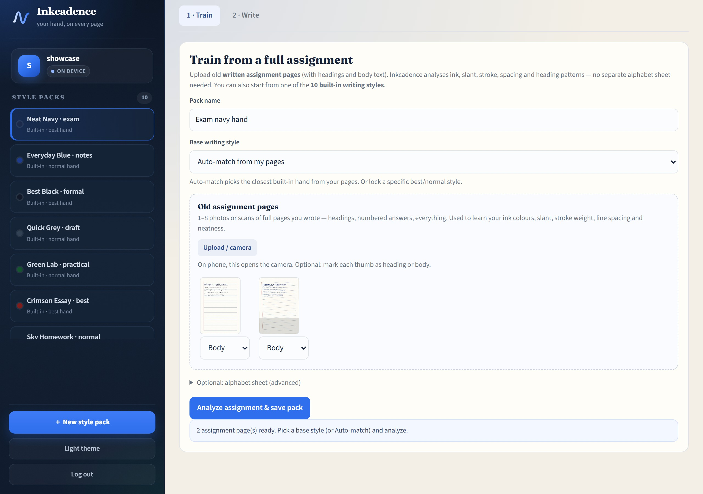 | 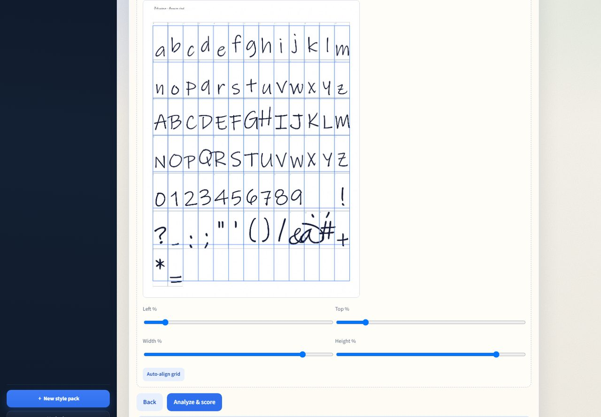 |
| **Quality 89** | **Saved letterforms** |
| 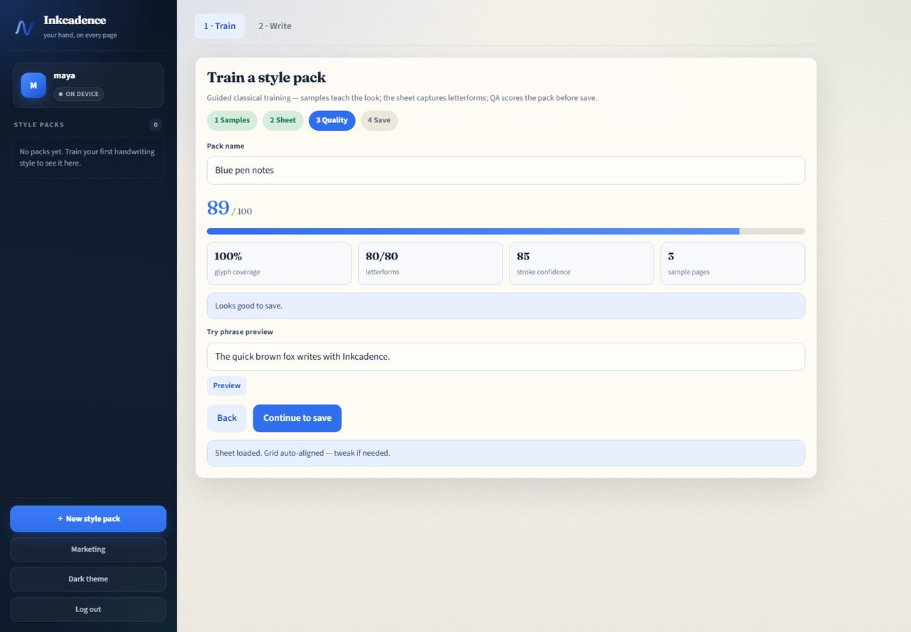 | 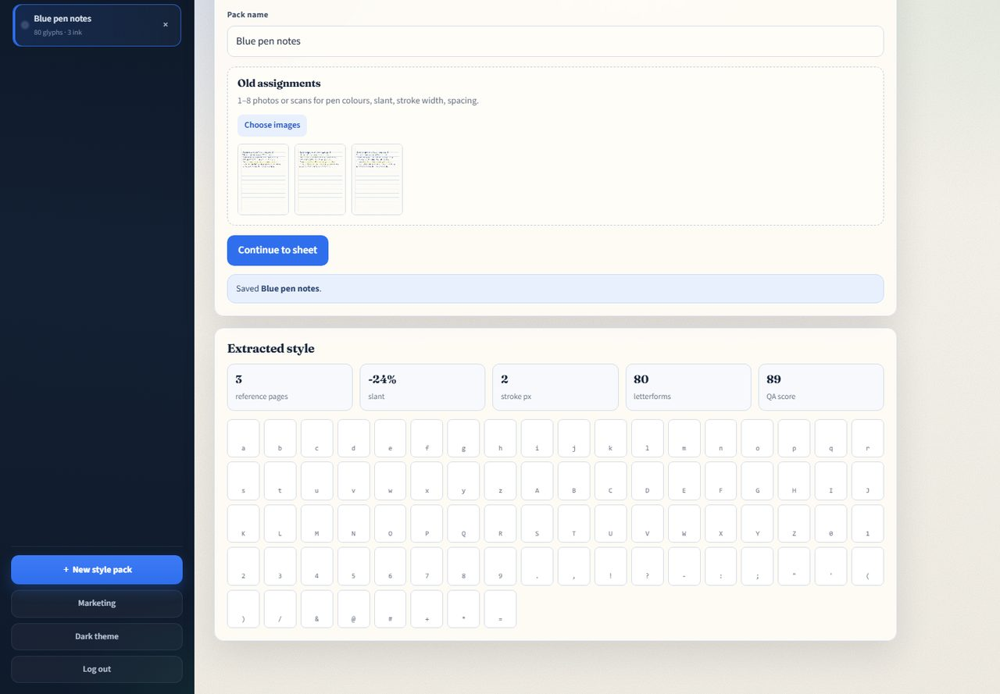 |

### GitHub workflows


Pushing to `main` runs [CI](.github/workflows/ci.yml) (tests, Vite build, API image, ML image) and [Pages](.github/workflows/pages.yml) (this guide, the screenshots, and the app at `/app/`).

## Stack

| Package | Role |
|---|---|
| `web/` | Vite ES-module app (Train / Write / marketing) |
| `js/` | Classical engines + GitHub Pages static fallback |
| `server/` | Hardened Express + Postgres (+ Redis rate limits) |
| `ml/` | FastAPI personalization + infer (Compose `--profile ml`) |

Style packs remain the source of truth. Neural artifacts hang off the same pack (`model_status`, `model_uri`, `model_metrics`). Writer mode: `auto | classical | neural` with silent classical fallback.

## Quick start

**Static classical (no backend):** open `index.html` or `npx serve . -l 4173`.

**API + in-memory DB:**

```bash
npm install
npm run dev
```

**Vite UI (proxies `/api` → `:8080`):**

```bash
npm install --prefix web
npm run dev --prefix web
```

**Docker self-host (Postgres + Redis + API):**

```bash
cp .env.example .env
docker compose up -d --build
# optional neural: docker compose --profile ml up -d --build
```

## Tests

```bash
npm test          # API + frontend store + engine helpers
npm run lint
npm run build --prefix web
```

## Docs

- [`SELFHOST.md`](SELFHOST.md) — one-command deploy
- [`SAAS.md`](SAAS.md) — Stripe, email, quotas
- [`ML.md`](ML.md) — train / infer contract
- [`DEPLOY.md`](DEPLOY.md) — production checklist
- [`BACKEND.md`](BACKEND.md) — legacy API notes

## License

MIT
